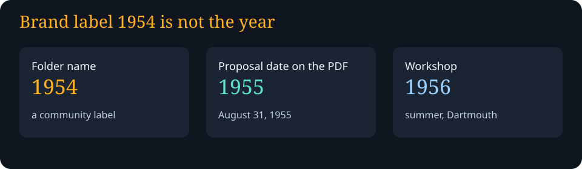
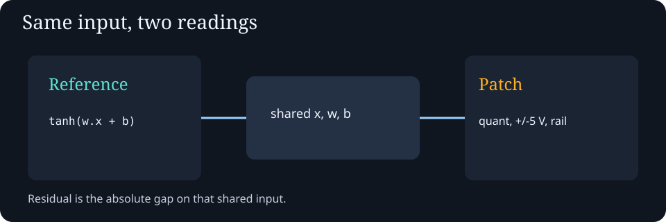
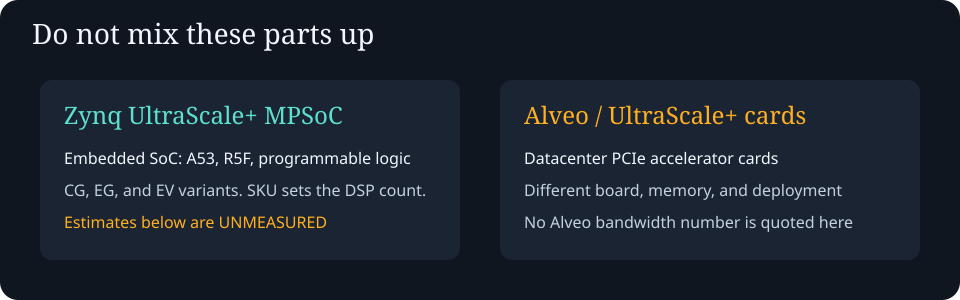

# Eurorack-Onwards
Meta-synthesis of the full Aidan Collins conversation on matrices vs lattices, Eurorack as continuous computation, Solomonoff/Dartmouth AI history, knowledge-graph self-improvement loop, and the inversion of code/signal domains. Contains the full synthesis document, reduced meta-document, and JSON knowledge graph for restarting any future session.
<!-- SYMPOSIUM-SYNTHESIS-1954-APPEND-BEGIN -->

## Symposium synthesis demos (additive)

Public teaching pages for a matrix mixer, a lattice fixed point, a finite prefix-free mixture, and an online update that can get worse. The folder name says 1954. The proposal date used here is August 31, 1955. The workshop was summer 1956. Feedback on these pages is computational, not physical time travel.

- Demos: [awesome-ai-symposium-synthesis-1954/index.html](awesome-ai-symposium-synthesis-1954/index.html)
- Research inventory: [research/README.md](research/README.md)
- Handoff: [META-HANDOFF.md](META-HANDOFF.md)
- Source: [signal-core.js](awesome-ai-symposium-synthesis-1954/implementations/signal-core.js)

The Node timing archived with the tests is a CPU comparison of an incremental dot-product update against a full recompute on one structured task. It is not a universal optimum and not a hardware benchmark. Details and gaps: `META-HANDOFF.md`.

<!-- SYMPOSIUM-SYNTHESIS-1954-APPEND-END -->
