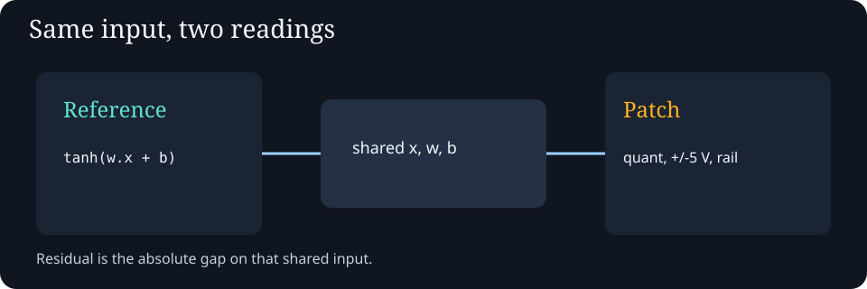
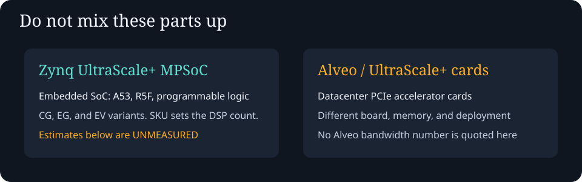

# Eurorack-Onwards
Meta-synthesis of the full Aidan Collins conversation on matrices vs lattices, Eurorack as continuous computation, Solomonoff/Dartmouth AI history, knowledge-graph self-improvement loop, and the inversion of code/signal domains. Contains the full synthesis document, reduced meta-document, and JSON knowledge graph for restarting any future session.
<!-- SYMPOSIUM-SYNTHESIS-1954-APPEND-BEGIN -->

## Symposium synthesis demos (additive)

Public teaching pages for a matrix mixer, a lattice fixed point, a finite prefix-free mixture, and an online update that can get worse. The folder name says 1954. The proposal date used here is August 31, 1955. The workshop was summer 1956. Feedback on these pages is computational, not physical time travel.

- Demos: [awesome-ai-symposium-synthesis-1954/index.html](awesome-ai-symposium-synthesis-1954/index.html)
- Research inventory: [research/README.md](research/README.md)
- Handoff: [META-HANDOFF.md](META-HANDOFF.md)
- Source: [signal-core.js](awesome-ai-symposium-synthesis-1954/implementations/signal-core.js)

The Node timing archived with the tests is a CPU comparison of an incremental dot-product update against a full recompute on one structured task. It is not a universal optimum and not a hardware benchmark. Details and gaps: `META-HANDOFF.md`.

<!-- SYMPOSIUM-SYNTHESIS-1954-APPEND-END -->
<!-- TEMPORAL-FORMALISM-APPEND-BEGIN -->

## Temporal Formalism: Turing Machine and LFSR (additive)

The Music Thing Turing Machine module is a 16-bit looping shift register with a probabilistic bit flip. Simulated: locked loop period 16, double lock period 32. An LFSR is residual feedback over GF(2) with maximal period 65535. Doc, sim and figure: [temporal-formalism/](temporal-formalism/README.md). Source stage: continuum-evolution `temporal-formalism/stage5-bits/`.
<!-- TEMPORAL-FORMALISM-APPEND-END -->
<!-- 2026-11-23-INFIX-STACKS-TRANSFORMER-APPEND-BEGIN -->

## Infix, In-Stacks, and Instant Sort at Every Transformer Layer (additive, 2026-11-23)

**Source:** voice conversation, 2026-11-23. Append-only. Nothing prior rewritten.

### Infix operator

An infix operator sits between its arguments — plus or times — as opposed to prefix (negation) or postfix (factorial). That is the whole definition.

### "In stacks" as fever dream

The word *infix* surfaced a prior thought: the idea of things *in stacks* — whether "in stacks" was real, or whether it was a fever-dream framing. The more likely reading offered: the *instant sort* is happening at every layer in a transformer-type translational network.

### Transformer as translational system of transformations

A transformer-type network is a translational system made of transformations. It is so much more powerful than a merely translational system, yet it takes advantage of the fact that sequences themselves can be transformed — because sequences are super-geometric, super-mathematical. They are cast back onto themselves.

Open thread for this chat: figure out that part — the self-cast of sequences onto their own geometric structure inside a layered translational stack.

### Speculative-history method (retained from same session)

Go off of speculative history, then figure out how to shore it up and why it is wrong, then use the speculative history anyway if it is wrong. That is how these things sort of work: if you use a technique and it works, you get to know how it works, then you use it again, get to know it, memorize it. That loop is the important thing to keep writing down.

<!-- 2026-11-23-INFIX-STACKS-TRANSFORMER-APPEND-END -->
