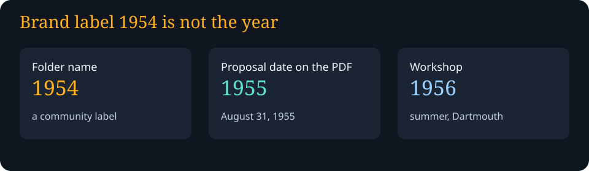
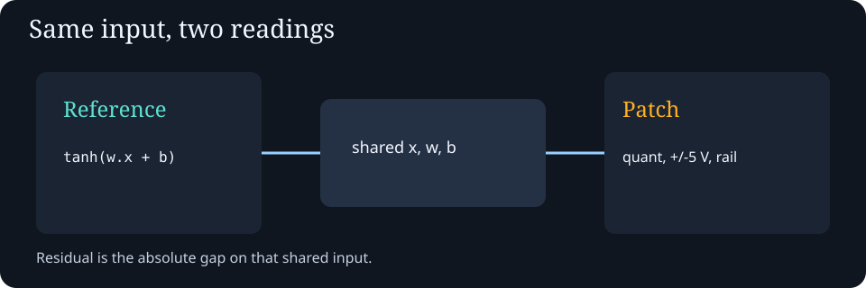
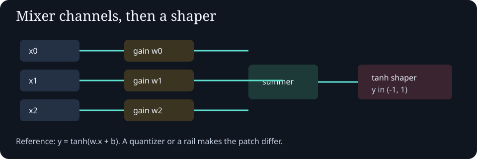
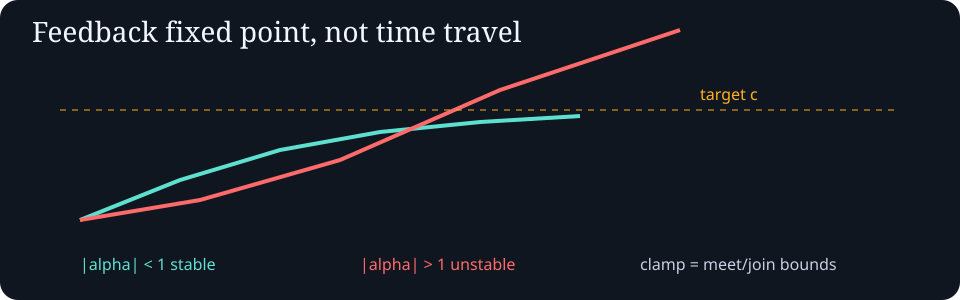
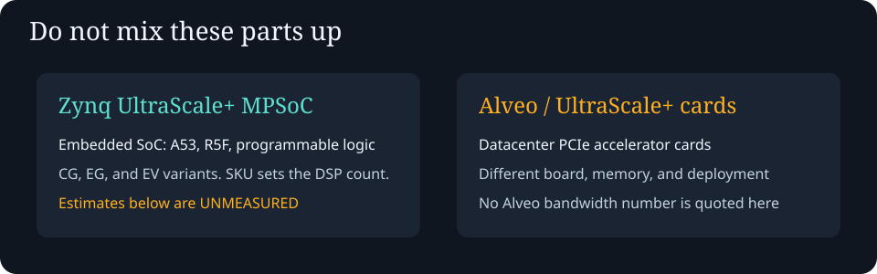
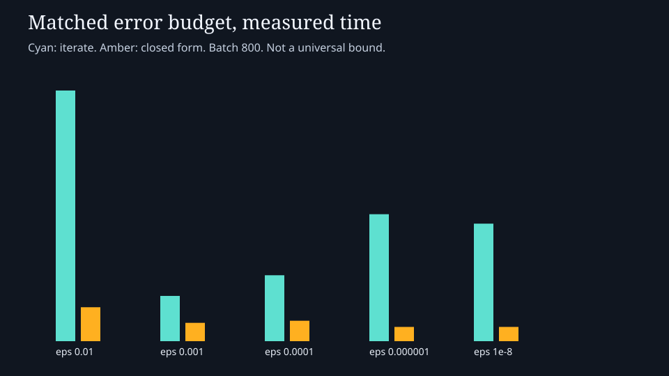

# awesome-ai-symposium-synthesis-1954

The folder name is a brand label. The Dartmouth proposal PDF prints **August 31, 1955**. The workshop was **summer 1956**. Weaver is not treated as a 1955 proposal co-author.

This directory is a public, non-proprietary teaching project: CPU simulations of a matrix mixer, a feedback fixed point, a finite Solomonoff-style mixture, and an online update that is allowed to get worse. Research notes are in [`../research/README.md`](../research/README.md). The handoff for another chat is [`../META-HANDOFF.md`](../META-HANDOFF.md).

## Open the demo

[index.html](index.html) is the interactive page (also the intended GitHub Pages path once hosting is on). Source is [implementations/signal-core.js](implementations/signal-core.js) and [implementations/signal_core.py](implementations/signal_core.py). Nothing is minified. LLM-facing instructions: [llms.txt](llms.txt) and [docs/llms.md](docs/llms.md).

## What was tested

`node tests/run-all.mjs` and `python3 tests/test_signal_core.py` write [`results/claims-verdicts.json`](results/claims-verdicts.json). The archived Node timing is [`results/node-bench.json`](results/node-bench.json).

On that run, n=256 and 2,000 weight edits: incremental median **0.129 ms** versus recompute median **1.004 ms** (ratio **0.128**), absolute error about **2×10⁻¹⁵**, flops **6,512** versus **1,024,000** including preprocess. State is 2,056 bytes. At one edit, incremental flops are slightly higher (515 versus 512). That is a structured-update tradeoff on this CPU. It is not a proof that the method beats every algorithm, and it is not a Eurorack or FPGA result.

The PNG of the same chart is [assets/residual-frontier.png](assets/residual-frontier.png).

## Modules and patches

- [modules/cv-mapping-range-scaling.md](modules/cv-mapping-range-scaling.md)
- [circuits/matrix-mixer.md](circuits/matrix-mixer.md)
- [circuits/lattice-feedback.md](circuits/lattice-feedback.md)
- [patches/mixer-neuron-patch.md](patches/mixer-neuron-patch.md)
- [patches/fixedpoint-feedback-patch.md](patches/fixedpoint-feedback-patch.md)
- [patches/occams-mixer-patch.md](patches/occams-mixer-patch.md)

## Not done

The files in [seeds/](seeds/) are the old untested sketches. Per-paper Solomonoff simulators, a Hebbian Rochester net, a More prover, a parallel-history script, and any physical Zynq run are planned. See [`../research/planned-simulations.json`](../research/planned-simulations.json).

Zynq UltraScale+ SKU tables and an explicitly unmeasured arithmetic example: [`../research/citations/amd-zynq-ultrascale-plus-mpsoc.md`](../research/citations/amd-zynq-ultrascale-plus-mpsoc.md).
