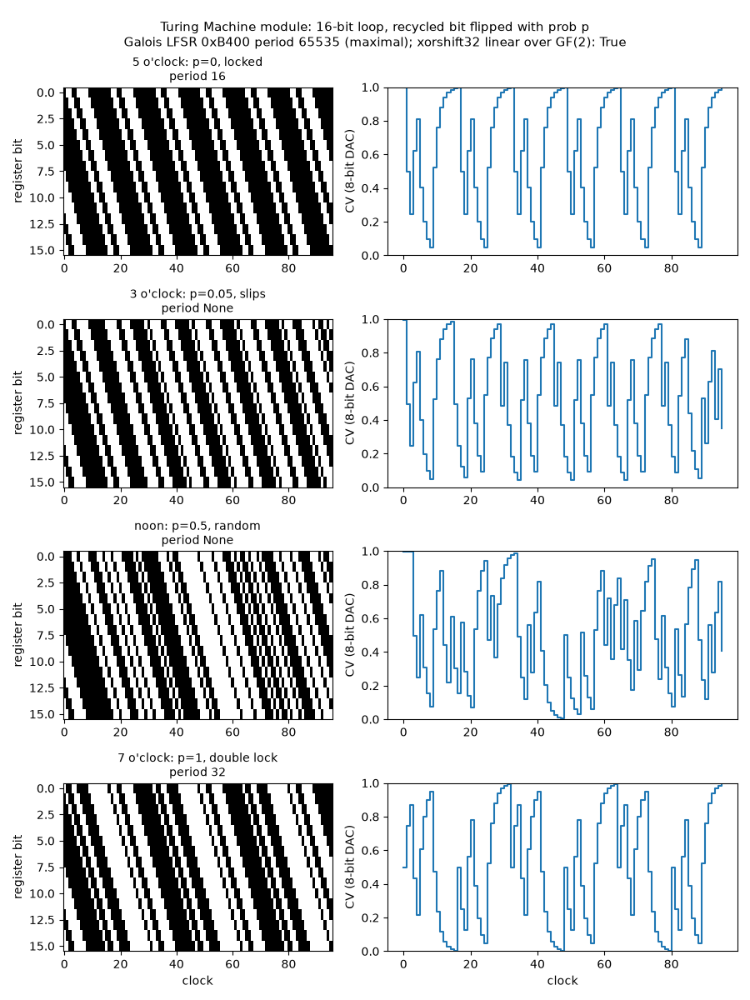

# Temporal Formalism: Turing Machine module and LFSRs

This page brings the Eurorack-relevant result of Stage 5 (claims B14–B16) from [arccoxx/continuum-evolution, `temporal-formalism/stage5-bits/`](https://github.com/arccoxx/continuum-evolution/tree/main/temporal-formalism/stage5-bits) into this repo. The script is standalone: `python turing_machine_lfsr.py` (numpy + matplotlib) writes `figures/turing_machine_lfsr.png`.

## What the module is (verified against the designer's page)
The [Music Thing Modular Turing Machine](https://www.musicthing.co.uk/Turing-Machine/) is a binary sequencer built around a **16-bit shift register** loop. The big knob sets how likely the recycled bit is to be **flipped** as it re-enters the loop:
- **Noon:** random.
- **5 o'clock:** locked into a repeating loop.
- **7 o'clock:** double lock, a loop twice the length setting.
- **3 o'clock / 9 o'clock:** slips (loops, but occasionally changes notes).

The name does not mean a Turing machine in Alan Turing's sense; the designer says so himself.

## Results
| claim | verdict | evidence |
|---|---|---|
| B16: the module is a looping shift register with a probabilistic bit flip | supported | Sim periods: p = 0 gives **16** (locked). p = 1 gives **32** (double lock: always inverting gives a loop of 2L whose second half is the complement of the first). p = 0.05 and 0.5 never repeat. |
| B14: "flipping the LSB into a generator" = an LFSR | supported, corrected | Galois LFSR: `out = s & 1; s = (s >> 1) ^ (out ? 0xB400 : 0)` has period **65535** (maximal). It is linear over GF(2), so 2n = 32 output bits recover it (Berlekamp–Massey): good noise and sequences, but not cryptographic. |
| B15: an LFSR is residual feedback over GF(2) | supported | The bit shifted out (the "residual") is fed back through the tap polynomial. It is an autonomous member of the Stage 3 residual-feedback family RF[S,Q,H] with S = GF(2), Q = shift, H = taps. xorshift32 is a 32×32 GF(2) matrix (checked here and with the Stage 4 GF(2) einsum). |

## In hardware
- The module's CV out is a DAC of 8 register bits, so the knob sweeps from a frozen melody to a slowly mutating one to noise. Steve Reich's "gradual process" is the stated inspiration.
- Shift-register noise sources (Buchla 266 Source of Uncertainty, Grant Richter's Noisering, Triadex Muse) are the lineage the designer cites.
- Clock dividers are the counter-bit version: bit k toggles every 2^k clocks (the ruler sequence, CTZ(n)).

Sources: Music Thing Modular, *17 things to know about Turing Machine*; Golomb, *Shift Register Sequences* (1967); Marsaglia (2003), *Xorshift RNGs*, J. Stat. Softw. 8(14). The full stage, with 18 claims, 8 figures and 27 sources, is in continuum-evolution `temporal-formalism/stage5-bits/`.
