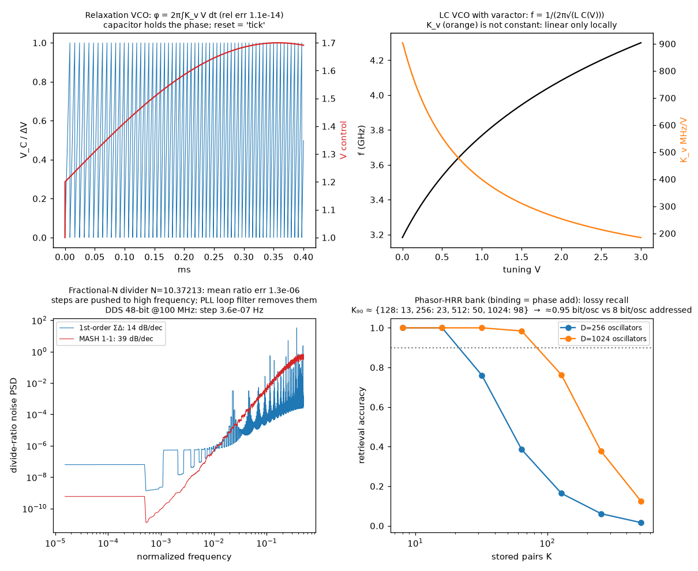
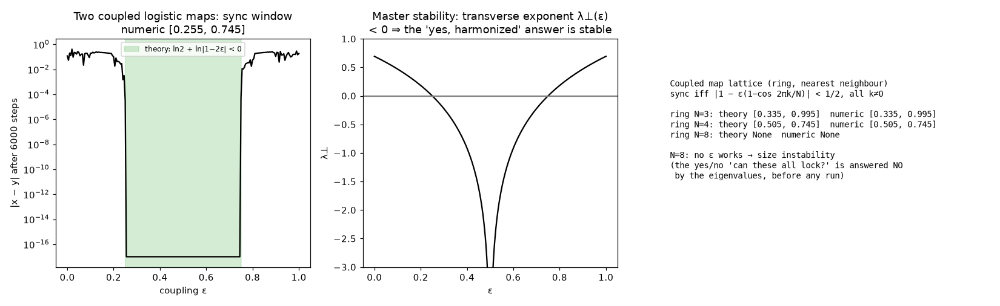
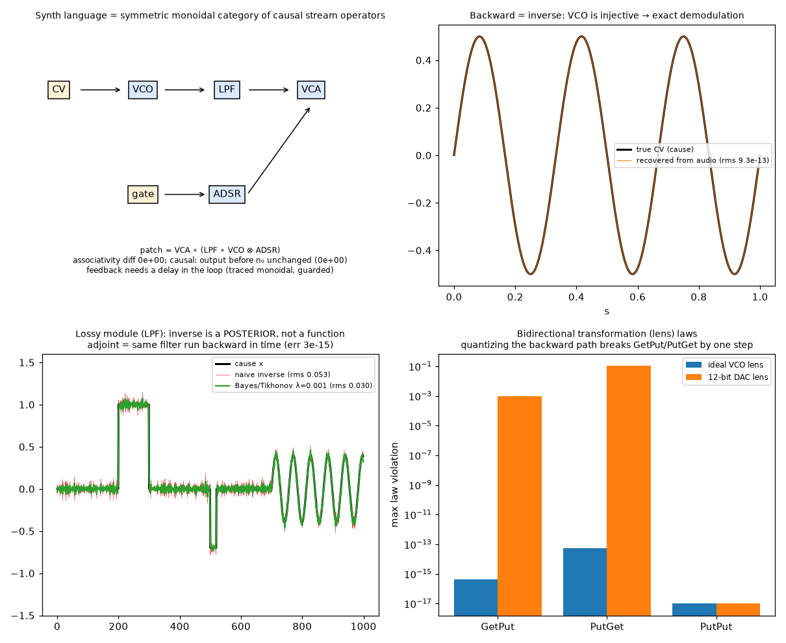

# t3u module specs: VCO-as-clock, harmonization tester, bidirectional (lens) modules

Source analysis: `continuum-evolution/temporal-formalism/stage2b-supplement/throughline/` (items A, B, D and F). These are specs and simulations only; no hardware has been built.

*Relaxation VCO: the capacitor voltage is the phase (error 1.1e-14). The LC VCO's K_v varies 5×. Fractional-N noise is pushed out of band. A phasor-HRR bank stores about 0.95 bit per oscillator.*

## 1. Addressless phase-register VCO (relaxation core)
- **Core:** a current source g·V_cv charges C; a comparator at ΔV resets it and emits a tick. Then f = gV/(CΔV) and φ = 2π(k + V_C/ΔV).
- **Outputs:** saw (= phase), tick (= reset), and a k counter (8-bit, CTZ-tapped like the Stage 5 Turing Machine module).
- **Hold mode:** cut the current, and phase is retained with drift I_leak/(CΔV). With 1 nF and 1 pA that is 6.3e-3 rad/s.
- **Spec:** K_v trim; 1 V/oct requires an exponential converter (translinear, st6:M16) ahead of g.

## 2. Harmonization (lock-range) tester
- **Inputs:** two clocks A and B. A PLL-style mixer (heterodyne) feeds a phase detector, which feeds an LPF, which feeds the B VCO's CV through coupling pot K.
- **LEDs:** "beat" (|Δω| > K, the slip rate √(Δω² − K²)) and "lock" (|Δω| ≤ K).
- **Ratio switch (1:1, 2:3, 3:4):** locks at p:q, so turning K walks across the Arnold tongues.
- **Mutual mode:** couple both ways, and lock holds for |Δω| ≤ 2K.

## 3. Chaos yes/no bit source (logistic r = 4)
- A digital module iterates x ↦ 4x(1−x) at 32-bit fixed point. The gate output is [x > 1/2], one Gray-coded bit per clock.
- **Honest spec:** a finite-precision orbit is periodic. Faithful to the true orbit for about (bits) steps; statistics hold by shadowing.
- **Coupled pair:** two modules with coupling ε. The sync LED lights for ε ∈ (1/4, 3/4).

## 4. Bidirectional (lens) modules

- Every module carries a forward path and an adjoint (time-reversed) path.
  - **VCO:** forward = CV→audio; backward = FM demodulator (exact).
  - **LPF:** forward = filter; backward = the same filter run on a time-reversed buffer, plus a regularized inverse (posterior).
  - **Quantizer:** backward is one LSB coarse (lens laws break by one step).
- **Patch rule:** any feedback cable must pass through a delay (≥ 1 sample or a delay module). Otherwise the patch is undefined (guarded trace).
